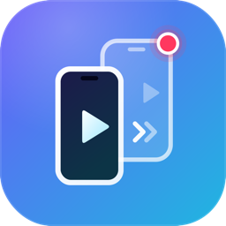
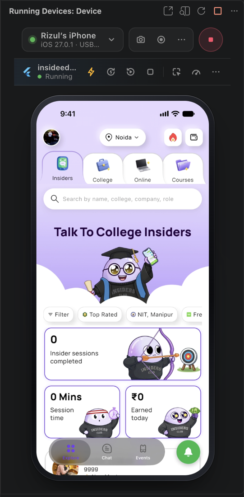
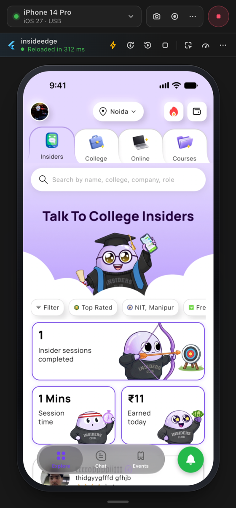
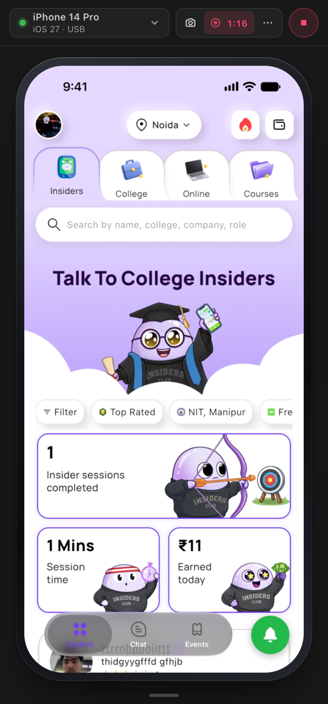
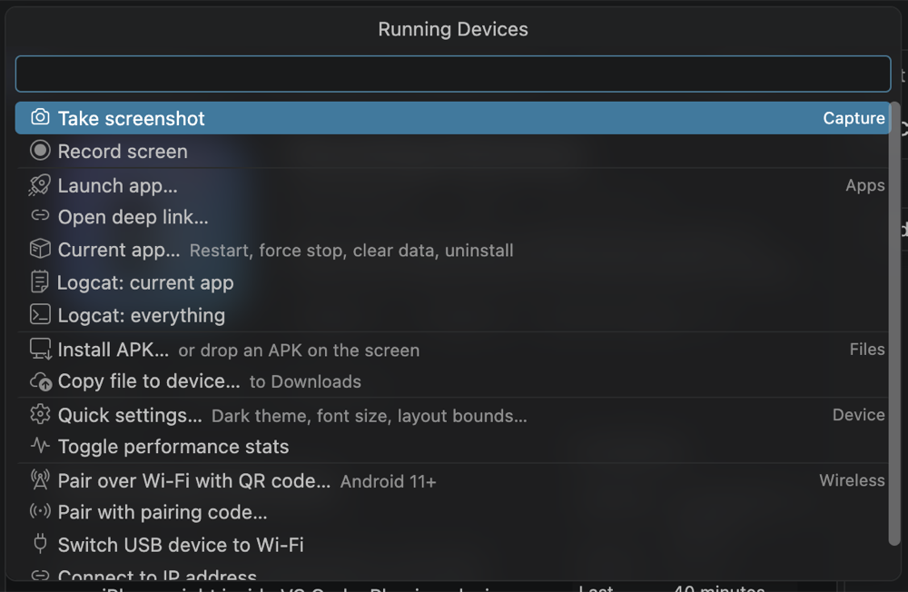
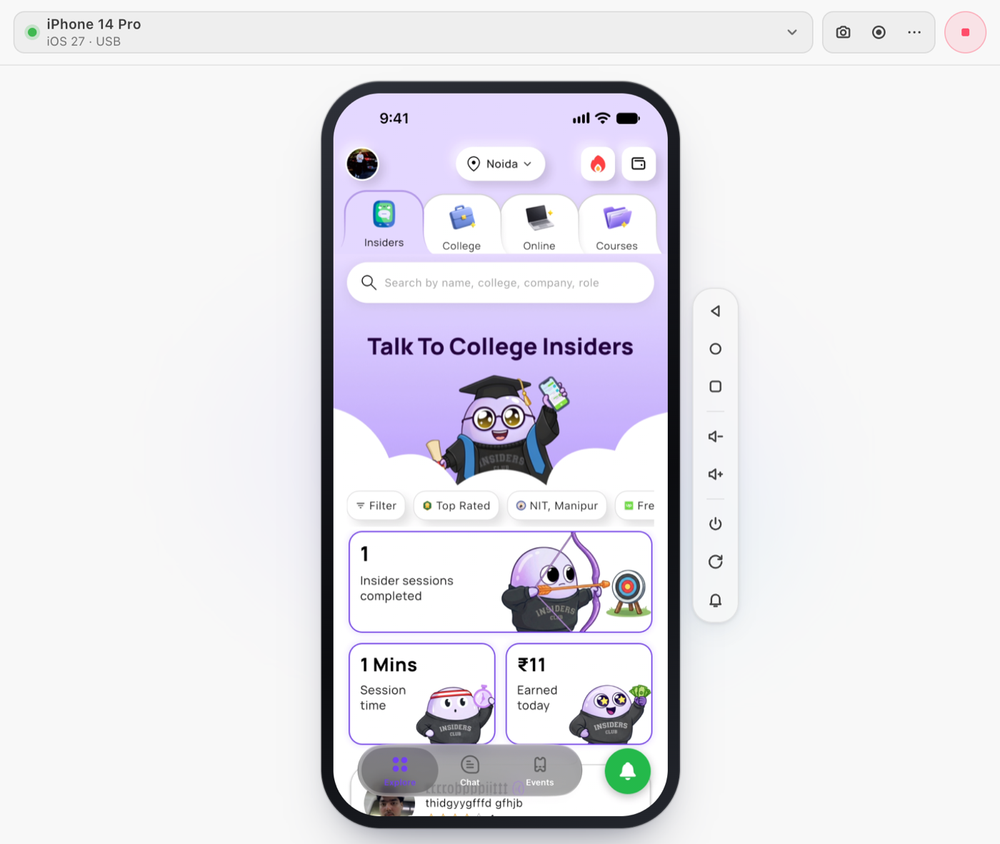
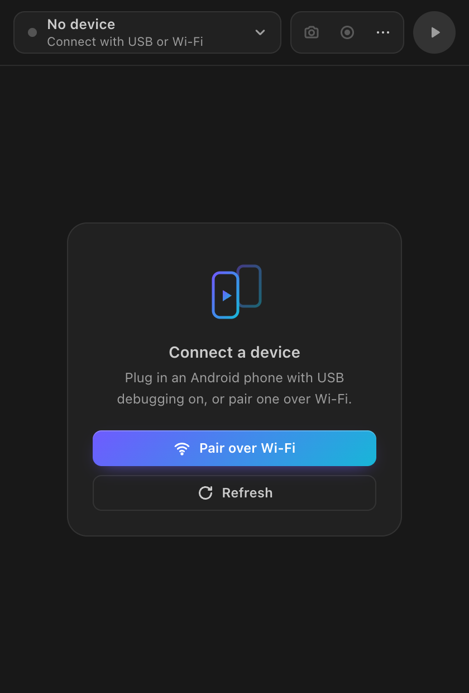

  

<h1 align="center">Running Devices</h1>

  <b>Your phone, live inside VS Code.</b> 
  Mirror and control Android and iPhone, hot reload Flutter, record, and debug, without leaving your editor.

  
  
  

  

---

## Highlights

|  |  |
| --- | --- |
| 📱 **Android and iPhone, side by side** | Plug in a phone and its screen appears next to your code at up to 60 fps. Emulators work too. |
| 👆 **Real control** | Click to tap, drag to swipe, scroll, and type straight into the device. |
| ⚡ **Flutter built in** | Hot reload, hot restart, the widget inspector and DevTools, right above the screen. |
| 🎬 **Capture** | Full-resolution screenshots and MP4 screen recordings with no time limit. |
| 🪵 **Logs that survive a kill** | Logcat and the iPhone device log keep running while your app is killed and relaunched, plus crash and kill reports. |
| 📶 **Wireless** | Pair an Android phone by scanning a QR code, or switch a USB phone to Wi-Fi in one click. |

Nothing to install on the phone, no root, no account.

## Get started

**Android**

1. Turn on **USB debugging** (Settings → About phone → tap *Build number* 7 times → Developer options → *USB debugging*).
2. Connect the phone with a cable and accept the *Allow USB debugging?* prompt.
3. Click the **Running Devices** icon in the activity bar. With one device connected, mirroring starts on its own.

**iPhone and iPad** (macOS)

1. Connect with a **USB cable**, unlock the phone, and tap **Trust** if asked.
2. Pick it from the device list and press ▶. The first time, macOS asks to allow **Camera** access for VS Code; that's how macOS labels iPhone screen capture (QuickTime uses the same permission).

## Flutter, built in

When a Flutter app started from VS Code runs on the mirrored device, a **Flutter bar** appears above the screen:

- **Hot reload** and **hot restart** with live status: *Hot reloading…* → *Reloaded in 312 ms*. Reloads on save show up too.
- **Restart** and **Stop** the app.
- **Inspect widget**: turn it on, tap any widget on the mirrored screen, and VS Code jumps to its code.
- **DevTools**, plus debug painting, performance overlay, slow animations and repaint rainbow under **⋯**.

Not running yet? The bar offers **Run on this device**, using your `launch.json` configuration when you have one.

Works on Android and iPhone. Requires the [Flutter extension](https://marketplace.visualstudio.com/items?itemName=Dart-Code.flutter).

 

## iPhone and iPad

- **Live mirroring** over USB, at the device's native sharpness.
- **Touch control** (optional): choose **⋯ → Enable touch control** once. Running Devices builds [WebDriverAgent](https://github.com/appium/WebDriverAgent) with your Apple Development signing and installs it on the iPhone; from then on you can tap, swipe and type from VS Code, and it starts by itself whenever you mirror. Needs Xcode and Developer Mode on the iPhone. Taps land about half a second after the click.
- **Device log** (⋯ → *Device log: app…*): the iPhone's live log for your app. It keeps running while the app is killed, so you can follow a cold start from a notification or a link. Each relaunch is marked.
- **Crash & kill reports** (⋯ → *Crash & kill reports…*): crashes, CPU-limit kills and memory kills for your app, each with a readable summary and the crashing stack.
- **Screenshots**, **screen recording** and the **Flutter bar** work just like on Android.

 

## Android toolkit

Everything is one click away in the **⋯** menu (and in the Command Palette under *Running Devices*):

- **Logcat** for the app in the foreground, in a colored terminal. It follows the app across restarts, so killed-state launches are logged from the first line.
- **Install APKs** by dropping them on the screen or right-clicking them in the Explorer. Drop any other file to copy it to the phone's Downloads.
- **Apps**: launch any app, open a **deep link** (`myapp://…`) to test it, or restart, force stop, clear data and uninstall the current app.
- **Quick settings**: dark theme, font size, display size, layout bounds, show taps and animation speed, without touching the phone.
- **Wi-Fi**: pair with a QR code (Android 11+), or switch a cabled phone to Wi-Fi and unplug it.
- **Performance stats**: live fps, bitrate and resolution over the screen.

## Put it anywhere

- **Pop Out to Window** gives the device its own floating window, perfect for a second monitor.
- **Open in Editor Tab** puts it in a tab you can split next to your code.
- **Move View…** places the panel in the Secondary Side Bar, the bottom Panel, or back.

The screen always gets the most room: the controls sit beside or below the phone only when there's space to spare, and otherwise tuck behind a handle at the bottom edge. Switching places never reconnects to the device.

## Mouse and keyboard

| On your computer | On the device |
| --- | --- |
| Click / drag | Tap / swipe |
| Scroll wheel, trackpad | Scroll |
| Right-click or Esc | Back (Android) |
| Typing (click the screen first) | Types into the focused field |
| Cmd/Ctrl + V | Pastes your clipboard text |
| Hovering over the screen | Wakes the screen and keeps it on |

The control bar has Back, Home, Overview, Volume, Power (hold for the power menu), Rotate and Notifications. On iPhone they map to the matching gestures.

 

## Requirements

- **Android:** Android 5.0 or newer and `adb` (Android SDK Platform-Tools). It's found automatically in the SDK's default location or on your `PATH`; otherwise set `runningDevices.adbPath`.
- **iPhone/iPad:** macOS 14 or newer and a USB cable. Xcode is needed for touch control, device logs and crash reports.

## Settings

| Setting | Default | Description |
| --- | --- | --- |
| `runningDevices.adbPath` | auto-detect | Path to `adb` |
| `runningDevices.maxSize` | `1600` | Longest side of the video in pixels (`0` = full resolution) |
| `runningDevices.bitRate` | `8000000` | Video bit rate. Lower it on slow connections |
| `runningDevices.maxFps` | `60` | Frame-rate limit |
| `runningDevices.stayAwake` | `true` | Keep the device awake while mirroring |
| `runningDevices.autoStart` | `true` | Start automatically when a single device is connected |
| `runningDevices.wakeOnHover` | `true` | Turn the screen on when the mouse is over it |
| `runningDevices.captureFolder` | Desktop | Where screenshots and recordings go (supports `~` and `${workspaceFolder}`) |
| `runningDevices.openCaptures` | `true` | Open screenshots and recordings after saving |
| `runningDevices.logcatLevel` | `V` | Minimum Logcat level: V, D, I, W or E |
| `runningDevices.idevicesyslogPath` | auto-detect | `idevicesyslog` for the iPhone device log (ships with the Flutter SDK, or `brew install libimobiledevice`) |

## Troubleshooting

- **No devices found:** run `adb devices` in a terminal. If the phone shows as `unauthorized`, unlock it and accept the USB debugging prompt.
- **Black or frozen screen:** try `runningDevices.maxSize` = `1024`.
- **Quick settings say the phone blocks changes:** Xiaomi, OPPO, Realme and OnePlus phones need one more switch in Developer options: *Disable permission monitoring* (OPPO, Realme, OnePlus) or *USB debugging (Security settings)* (Xiaomi).
- **Wi-Fi pairing doesn't find the phone:** the phone and computer must be on the same network; some office and guest networks block discovery. Use *Pair with pairing code* or *Switch USB device to Wi-Fi* instead.
- **iPhone stays on "Waiting for video":** use a cable, unlock the iPhone, and allow Camera access for Visual Studio Code in System Settings → Privacy & Security → Camera.
- **iPhone touch control won't start:** unlock the iPhone, and trust your developer app once in Settings → General → VPN & Device Management.
- **Anything else:** View → Output → **Running Devices** shows the connection log.

## Privacy

Everything runs on your machine, over your cable or local network. Running Devices has no telemetry and sends nothing anywhere.

## Credits

Android screen capture uses [scrcpy](https://github.com/Genymobile/scrcpy) by Genymobile and Romain Vimont (Apache 2.0). iPhone touch control uses [WebDriverAgent](https://github.com/appium/WebDriverAgent) from the Appium project (BSD).
